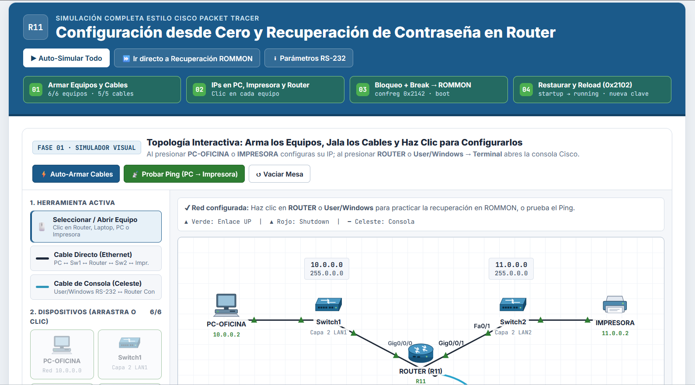

# Recuperación de Contraseña en Router Cisco IOS - Simulador 
URL: https://jchampi.github.io/Recuperar_Contrasenia_Router_Cisco/

Simulador educativo interactiva en un solo archivo HTML (`index.html`) que simula un laboratorio completo de redes al estilo **Cisco Packet Tracer**: desde el armado físico/lógico de equipos y cables, la configuración inicial de direccionamiento IP y contraseñas, hasta el procedimiento de **recuperación de contraseña mediante modo ROMMON (`0x2142` → `0x2102`)**.

---

## Estructura de la carpeta

```text
Recuperar_Contraseña_Router/
├── index.html     # Simulador completo (HTML5 + CSS3 + JS + SVG)
├── logica.jpeg    # Captura de la topología lógica en Cisco Packet Tracer
├── fisica.jpeg    # Captura de la vista física en rack y cableado de consola
└── README.md      # Documentación del proyecto
```

---

## Cómo usar el simulador

No requiere instalación, servidor web ni dependencias externas:

1. Abre `index.html` con doble clic en cualquier navegador moderno (Chrome, Edge, Firefox, Safari).
2. En la **Fase 01 (Mesa de Armado)**:
   - Arrastra (o haz clic en) los 6 dispositivos (`PC-OFICINA`, `Switch1`, `ROUTER`, `Switch2`, `IMPRESORA`, `User/Windows`) al plano.
   - Selecciona **Cable Directo (Ethernet)** o **Cable de Consola (Celeste RS-232)** y conecta los equipos arrastrando de un nodo a otro (o usa **Auto-Armar Cables**).
3. Cambia a **Seleccionar / Abrir Equipo** y haz clic en cada dispositivo:
   - **PC-OFICINA**: configura su IPv4, máscara y gateway en `IP Configuration`, o prueba `ipconfig` y `ping 11.0.0.2` en `Command Prompt`.
   - **IMPRESORA**: asigna su IPv4, máscara y gateway en `Config`.
   - **ROUTER**: usa la pestaña `Physical` (interruptor físico ON/OFF) y la pestaña `CLI` (consola Cisco IOS / ROMMON).
   - **User/Windows (Laptop)**: abre `Desktop` → `Terminal` → `OK` (`9600-8-N-1`) para administrar el router por cable de consola.
4. También puedes usar los botones superiores **Auto-Simular Todo** (reproduce todo el laboratorio desde cero) o **Ir directo a Recuperación ROMMON**.

---

## Topología y Direccionamiento del Laboratorio

| Dispositivo / Interfaz | Red | Dirección IP | Máscara | Gateway |
| :--- | :--- | :--- | :--- | :--- |
| **PC-OFICINA** (`Fa0`) | `10.0.0.0/8` | `10.0.0.2` | `255.0.0.0` | `10.0.0.1` |
| **ROUTER R11** (`Gig0/0/0`) | `10.0.0.0/8` | `10.0.0.1` | `255.0.0.0` | — |
| **ROUTER R11** (`Gig0/0/1`) | `11.0.0.0/8` | `11.0.0.1` | `255.0.0.0` | — |
| **IMPRESORA** (`Fa0`) | `11.0.0.0/8` | `11.0.0.2` | `255.0.0.0` | `11.0.0.1` |
| **User/Windows** (`RS-232`) | Consola | — | — | Conectada a `Console` del Router |

- **Switch1**: interconecta `PC-OFICINA` con `ROUTER (Gig0/0/0)`.
- **Switch2** (`Fa0/1`): interconecta `ROUTER (Gig0/0/1)` con `IMPRESORA`.

---

## Procedimiento de Recuperación de Contraseña (Cisco IOS)

### 1. Escenario bloqueado
Configurar las contraseñas, guardarlas y salir para quedar en la solicitud de inicio de sesión:
```cisco
R11# exit
Password:
```

### 2. Reinicio físico e interrupción (`Break`)
Apagar y volver a encender el router. Antes de que finalice la descompresión (`#################`), presionar la secuencia de interrupción:
- **Computadora de escritorio**: `Ctrl + Pausa` (`Ctrl + Break`)
- **Laptop**: `Ctrl + Fn + P`
- **En el simulador**: botón `Enviar Break` o `Ctrl + B`

### 3. Cambio de registro en ROMMON
```cisco
rommon 1 > confreg 0x2142
rommon 2 > boot
```
*(También se puede utilizar `reset` en lugar de `boot`. Esperar a que termine la carga `####...####`.)*

### 4. Cargar `startup-config` en `running-config`
```cisco
router> enable
router# copy startup-config running-config
R11#
```

### 5. Configurar nuevas contraseñas, guardar y restaurar `0x2102`
```cisco
R11# conf t
! Configurar las nuevas contraseñas (ej. enable secret / line console 0)
Router(config)# do write
Router(config)# config-register 0x2102
```

### 6. Confirmación en modo privilegiado y reinicio
```cisco
R11# copy startup-config running-config
R11# reload
```

---

## Tecnologías utilizadas

- **HTML5**: estructura semántica y Drag & Drop nativo.
- **CSS3**: diseño tipo infografía técnica, ventanas estilo Cisco Packet Tracer y diseño responsivo.
- **JavaScript (ES6+)**: máquina de estados de Cisco IOS / ROMMON, validación de red y `ping`, manejo de memoria NVRAM/RAM y cableado interactivo.
- **SVG**: iconos vectoriales realistas de dispositivos, enlaces dinámicos y animación de paquetes.
